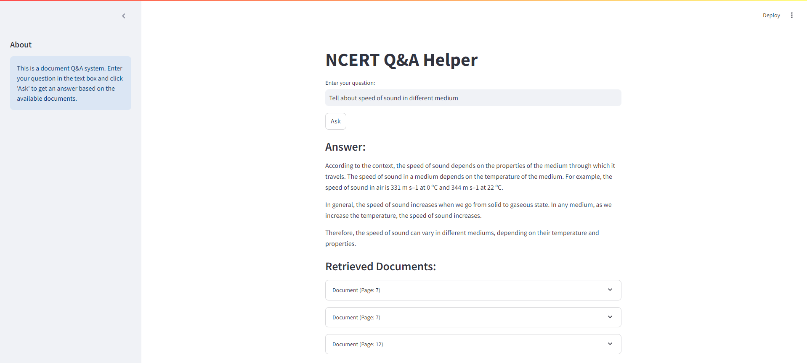
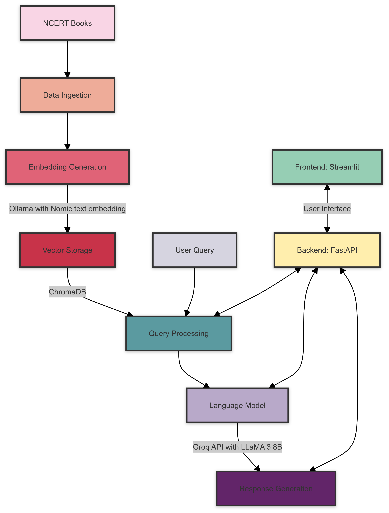
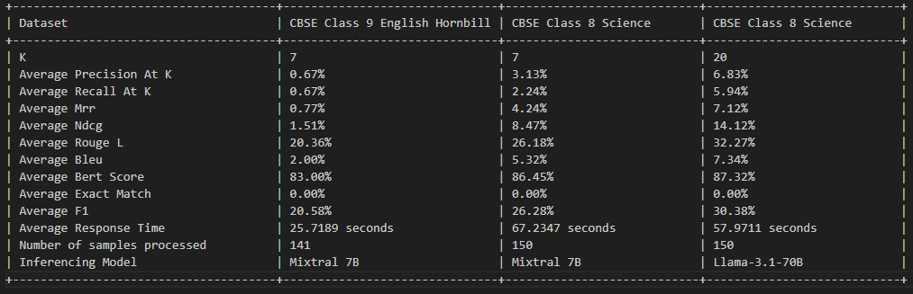

# NCERT Books RAG System

This project implements a Retrieval-Augmented Generation (RAG) system for NCERT books using Ollama for text embedding and vector database, and Groq API for the language model response.

## Features

- Uses Nomic text embedding model via Ollama for creating vector embeddings
- Stores embeddings in ChromaDB
- Utilizes Groq API with LLaMA 3 8B model for generating responses
- Provides a FastAPI backend and Streamlit frontend for user interaction

## Streamlit Interface

Below is a screenshot of the Streamlit interface for our NCERT Books RAG system:




## System Architecture

Here's an overview of the NCERT Books RAG system architecture:




The system architecture consists of the following components:

1. **Data Ingestion**: NCERT books are processed and prepared for embedding.
2. **Embedding Generation**: Ollama with the Nomic text embedding model creates vector embeddings for the processed text.
3. **Vector Storage**: ChromaDB stores the generated embeddings for efficient retrieval.
4. **Query Processing**: User queries are processed and relevant embeddings are retrieved from ChromaDB.
5. **Language Model**: Groq API with LLaMA 3 8B model generates responses based on the retrieved context and user query.
6. **Backend**: FastAPI handles the communication between the frontend and the various system components.
7. **Frontend**: Streamlit provides an interactive user interface for querying the system and displaying results.

## Prerequisites

Before you begin, ensure you have met the following requirements:

- Python 3.7+
- Ollama installed and set up
- Groq API account and API key

## Installation

1. Clone the repository:
   ```
   git clone https://github.com/yourusername/ncert-rag-system.git
   cd ncert-rag-system
   ```

2. Install the required dependencies:
   ```
   pip install -r requirements.txt
   ```

3. Download and set up Ollama:
   - Follow the instructions at [Ollama's official website](https://ollama.ai) to install Ollama
   - Download the Nomic text embedding model:
     ```
     ollama pull nomic-embed-text
     ```

4. Set up your Groq API key:
   - Create a `.env` file in the project root
   - Add your Groq API key:
     ```
     GROQ_API_KEY=your_api_key_here
     ```

## Usage

1. Start the FastAPI backend (from the project folder, using the project virtualenv):
   ```
   .venv312\Scripts\python -m uvicorn app:app --host 127.0.0.1 --port 8000
   ```
   If `GROQ_API_KEY` is unset, answers come from a local Ollama chat model (`OLLAMA_CHAT_MODEL`, default `llama3.2`). Embeddings always use Ollama `nomic-embed-text`.

2. Launch the Streamlit UI:
   ```
   streamlit run streamlit_app.py
   ```

3. Open your web browser and navigate to the Streamlit app URL (typically `http://localhost:8501`)

4. Use the interface to interact with the NCERT books RAG system

## RAG Evaluation

## 📊 Performance Evaluation: Top-k vs. Top-p Retrieval

We evaluated both retrieval strategies using the NCERT evaluation questions dataset and the English Hornbill vector database.

### 1. Evaluation Results

| Metric | Top-k (`k = 5`) | Top-p (`p = 0.85`) | Observation |
|:---|:---:|:---:|:---|
| **Avg. Retrieved Documents** | 5.00 | 10.20 | Top-p dynamically retrieves more documents based on cumulative probability. |
| **Precision@k** | 0.2000 | 0.2000 | Both methods achieve identical precision. |
| **Recall@k** | 0.2000 | 0.0982 | Top-k achieves higher recall in this evaluation. |
| **MRR (Mean Reciprocal Rank)** | 0.2233 | 0.2233 | Both methods show identical first-relevant-result ranking performance. |
| **NDCG** | 0.3723 | 0.3723 | Both methods maintain identical ranking quality. |
| **ROUGE-L Score** | 0.3269 | 0.3211 | Top-k achieves slightly higher lexical similarity. |
| **BLEU Score** | 0.0045 | **0.0066** | Top-p achieves approximately 46.7% higher BLEU score. |
| **BERT / Semantic Score** | 0.1831 | 0.1831 | Both methods achieve identical semantic similarity. |
| **Token F1** | 0.1461 | 0.1379 | Top-k achieves slightly higher token-level F1. |
| **Avg. Response Time** | **4.00 sec** | 18.18 sec | Top-k is significantly faster. |

### 2. Key Observations

- **Adaptive Retrieval:** Top-p retrieves an average of 10.20 documents compared to 5.00 documents in Top-k, demonstrating its ability to dynamically adjust the retrieval context.
- **Retrieval Quality:** Both methods achieve identical Precision@k, MRR, and NDCG scores, indicating similar measured retrieval ranking performance.
- **Answer Generation:** Top-p achieves a higher BLEU score (0.0066 vs. 0.0045), while Top-k performs slightly better on ROUGE-L and Token F1.
- **Semantic Similarity:** Both methods achieve an identical BERT score of 0.1831.
- **Response Time:** Top-k is considerably faster, taking 4.00 seconds compared to 18.18 seconds for Top-p.

### 3. Conclusion

Top-p retrieval introduces an adaptive document selection mechanism that determines the number of retrieved chunks based on a cumulative probability threshold (`p = 0.85`), rather than relying on a fixed number of documents.

Although Top-p retrieves more document chunks and achieves a higher BLEU score in this experiment, it also introduces additional response latency.

The evaluation demonstrates the trade-off between **adaptive context retrieval and computational efficiency**. Top-k remains faster, while Top-p provides a more flexible retrieval strategy.

Further experimentation with different probability thresholds and temperature values may help optimize the balance between retrieval quality, context size, and response time.



## License

This project is licensed under the MIT License - see the [LICENSE](LICENSE) file for details.

## Contributing

Contributions are welcome! Please feel free to submit a Pull Request.

## Acknowledgements

- [Ollama](https://ollama.ai) for providing the embedding model
- [Groq](https://groq.com) for their LLM API
- [FastAPI](https://fastapi.tiangolo.com) and [Streamlit](https://streamlit.io) for the backend and frontend frameworks
